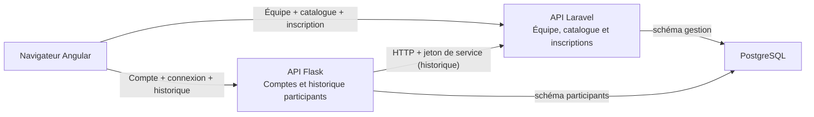

# SmartConseil — plateforme de gestion d’ateliers

Application web full stack réalisée pour l’exercice de développeur Full Stack
Angular / Laravel / Python. Elle permet de gérer des ateliers de formation et
les inscriptions de leurs participants.

## Fonctionnalités

| Profil | Fonctionnalités |
| --- | --- |
| Administrateur | Créer, modifier et supprimer des ateliers; gérer les formateurs; consulter les inscriptions et les participants. |
| Formateur | Consulter ses ateliers et les participants inscrits à ceux-ci. |
| Participant | Créer un compte, se connecter, consulter les ateliers disponibles, s’y inscrire et suivre ses inscriptions. |

## Connexion et accès

- **Administrateur et formateur**: utilisez `http://127.0.0.1:4200/login`.
  Cette page authentifie les comptes d’équipe auprès de l’API Laravel. Le
  premier administrateur est créé avec `php artisan app:create-admin`; les
  comptes formateur sont également gérés côté Laravel.
- **Participant**: créez un compte sur
  `http://127.0.0.1:4200/participant/creer-compte`, puis connectez-vous sur
  `http://127.0.0.1:4200/participant/connexion`. La création de compte et la
  connexion utilisent l’API Flask. Le catalogue est accessible sur
  `/participant/ateliers`; l’inscription aux ateliers passe ensuite par Laravel.
- La racine `http://127.0.0.1:4200/` redirige vers les ateliers participants.
  Les espaces d’équipe sous `/app` sont protégés et réservés aux administrateurs
  et formateurs. Les sessions participant et équipe sont indépendantes.

Le [MCD](<./MCD_Plateforme_Ateliers.pdf>) présente les entités, leurs relations
et la séparation des données entre les deux API.

## Architecture



- **Angular** fournit l’interface et communique avec Laravel pour les écrans
  d’administration et de formateur, le catalogue participant et les inscriptions.
  Flask gère la création de compte, la connexion et l’historique participant.
- **Laravel** est la source de vérité pour les ateliers, les formateurs et les
  inscriptions. Son API REST, protégée par Sanctum et des contrôles de rôles,
  gère ces ressources. Elle vérifie aussi le JWT participant signé par Flask
  pour créer une inscription; le secret partagé reste côté serveur.
- **Flask** gère les comptes et l’authentification des participants. Il appelle
  Laravel par HTTP uniquement pour l’historique participant, avec un jeton de
  service conservé côté serveur.
- **PostgreSQL** héberge les données dans des schémas distincts. Laravel possède
  le schéma `gestion`; Flask possède `participants`. Laravel conserve une
  référence minimale au participant pour afficher les listes d’inscrits. Les
  services échangent un UUID stable; ils ne lisent pas directement les tables
  appartenant à l’autre service.

## Choix techniques

Le sujet propose Angular 14 ou 16, Laravel/PHP, Flask ou Django et PostgreSQL
ou MySQL. Il ne fixe pas de versions précises pour PHP, Python, Node.js ou la
base de données. Les versions ci-dessous suivent les dépendances verrouillées,
la compatibilité des frameworks et la configuration CI du projet.

| Technologie | Proposition du sujet | Choix du projet et raison |
| --- | --- | --- |
| Angular, TypeScript, RxJS | Angular 14 ou 16 | Angular 16.2 (core 16.2.12, CLI 16.2.16), TypeScript 5.1.6 et RxJS 7.8.2. Angular 16 est l’option la plus récente permise par le sujet; ces versions sont compatibles avec le code et son outillage verrouillé. |
| Node.js | Non précisé | Node 18.20 pour Angular 16; le CI utilise Node 18. Le build Vite facultatif de Laravel requiert Node 20.19 ou supérieur, mais n’est pas nécessaire pour lancer l’API Laravel. |
| Laravel, PHP, Sanctum | Laravel/PHP, sans version précisée | Laravel 13.42 et Sanctum 4.4 gèrent l’API métier et les jetons d’équipe. Le manifeste autorise PHP 8.3+, mais les dépendances Symfony 8 verrouillées exigent PHP 8.4.1 ou supérieur. |
| Flask, Python, SQLAlchemy | Flask ou Django | Flask 3.1.3 est choisi pour l’API participant, plus réduite qu’une application Django complète. Python 3.12 est la version du CI; SQLAlchemy 2.0.58 persiste les comptes et Alembic versionne leur schéma. |
| Requests | Appels HTTP Python → Laravel suggérés | Requests 2.34.2 sert à récupérer l’historique participant depuis Laravel avec un délai d’attente et un jeton serveur limité. |
| PostgreSQL | PostgreSQL ou MySQL | PostgreSQL 17 en développement; le CI teste aussi avec PostgreSQL 16. Ses schémas permettent de séparer `gestion` (Laravel) et `participants` (Flask) dans une même base. |
| API | API REST attendue | REST/JSON sous `/api/v1` fournit des contrats explicites entre Angular, Flask et Laravel. |

Angular 16 et Node 18 répondent donc aux options de l’exercice; les autres
versions sont des choix de compatibilité propres au projet, pas des exigences
imposées par le sujet. Si vous devez construire les assets Vite de Laravel,
utilisez Node 20.19+ pour cette commande, séparément du démarrage API décrit ici.

## Prérequis

- Windows PowerShell (les commandes ci-dessous sont prévues pour Windows).
- PHP 8.4.1 ou supérieur et Composer.
- Python 3.12.
- Node.js 18 et npm pour Angular. Le build Vite facultatif de Laravel nécessite
  Node.js 20.19 ou supérieur.
- PostgreSQL 17 en fonctionnement.

## Installation locale

Les services utilisent une même base PostgreSQL, mais chacun possède son propre
schéma. Les fichiers `.env` sont locaux et ne doivent pas être commités.

### 1. Créer la base PostgreSQL

Dans pgAdmin ou `psql`, créez un rôle et une base. Remplacez le mot de passe par
un secret local; exécutez les commandes séparément:

```sql
CREATE ROLE smartconseil_app WITH LOGIN PASSWORD 'choisir-un-mot-de-passe';
CREATE DATABASE smartconseil OWNER smartconseil_app;
```

### 2. Installer et configurer Laravel

Dans un nouveau terminal PowerShell, depuis la racine du dépôt:

```powershell
cd "Back-end Laravel"
composer install
if (-not (Test-Path .env)) { Copy-Item .env.example .env }
```

Dans `Back-end Laravel/.env`, renseignez `DB_CONNECTION=pgsql`,
`DB_HOST=127.0.0.1`, `DB_PORT=5432`, `DB_DATABASE=smartconseil`,
`DB_USERNAME=smartconseil_app` et le mot de passe créé précédemment. Puis:

```powershell
php artisan key:generate
php artisan config:clear
php artisan migrate
php artisan app:create-admin
php artisan serve --host 127.0.0.1 --port 8000
```

La commande `app:create-admin` demande le nom, l’adresse courriel et un mot de
passe administrateur. Les migrations Laravel créent les tables du schéma
`gestion`.

Le dépôt ne crée aucun compte de démonstration: le seeder Laravel est vide.
L’administrateur est créé avec la commande ci-dessus; il n’existe pas de
courriel ou mot de passe formateur par défaut. La création de formateur n’a pas
d’écran Angular: un administrateur la fait via l’API, après avoir obtenu son
jeton à l’étape suivante. Ne mettez pas de vrais mots de passe dans le dépôt.
Les participants créent eux-mêmes leur compte sur
`http://127.0.0.1:4200/participant/creer-compte`. Les mots de passe de la
factory Laravel (`password`) sont réservés aux tests automatisés et ne sont
pas des identifiants d’application.

### 3. Créer un jeton de service Laravel

Après avoir démarré Laravel, ouvrez un autre terminal PowerShell et remplacez
les identifiants ci-dessous par ceux de l’administrateur créé à l’étape
précédente:

```powershell
$api = 'http://127.0.0.1:8000/api/v1'
$login = Invoke-RestMethod -Method Post -Uri "$api/auth/login" `
    -ContentType 'application/json' `
    -Body (@{
        email = 'admin@example.test'
        password = '<mot-de-passe-admin>'
    } | ConvertTo-Json)
$headers = @{
    Authorization = "Bearer $($login.access_token)"
    Accept = 'application/json'
}
$service = Invoke-RestMethod -Method Post -Uri "$api/auth/python-token" `
    -Headers $headers
$service.access_token
```

Copiez le jeton affiché uniquement dans le fichier `.env` local de Flask, sous
`LARAVEL_SERVICE_TOKEN`. Ne l’insérez jamais dans Angular ni dans le dépôt Git.
Les nouveaux jetons ont uniquement le droit `registrations:read`. Les anciens
jetons conservent leurs droits précédents jusqu’à leur révocation; révoquez tout
ancien jeton Python puis créez-en un nouveau.

#### Créer deux comptes formateur de test

Le jeton administrateur obtenu plus haut doit être envoyé comme bearer token à
`POST /api/v1/formateurs`. Répétez la requête avec un courriel unique pour
chaque compte; choisissez les mots de passe localement (12 caractères minimum),
puis connectez-vous sur `http://127.0.0.1:4200/login`:

```http
POST http://127.0.0.1:8000/api/v1/formateurs
Authorization: Bearer <jeton-administrateur>
Content-Type: application/json

{
  "nom": "<nom-du-formateur>",
  "email": "<adresse-courriel-unique>",
  "password": "<mot-de-passe-local>",
  "password_confirmation": "<meme-mot-de-passe>"
}
```

### 4. Installer et configurer Flask

Dans un troisième terminal PowerShell, depuis la racine du dépôt:

```powershell
cd "Back-end Python"
py -3.12 -m venv .venv
.\.venv\Scripts\python.exe -m pip install -r requirements.txt
if (-not (Test-Path .env)) { Copy-Item .env.example .env }
```

Dans `Back-end Python/.env`, configurez:

- `DATABASE_URL` vers la base `smartconseil`, avec le rôle PostgreSQL créé plus
  haut; encodez les caractères spéciaux du mot de passe dans l’URL.
- `JWT_SECRET_KEY` avec une clé privée d’au moins 32 caractères.
- `PARTICIPANT_JWT_SECRET` dans `Back-end Laravel/.env` avec la même valeur que
  `JWT_SECRET_KEY`, afin que Laravel puisse vérifier les JWT participants.
- `LARAVEL_SERVICE_TOKEN` avec un jeton limité à `registrations:read`; Flask
  l’utilise uniquement pour afficher l’historique participant. Ne l’exposez
  jamais dans Angular.
- `LARAVEL_API_URL=http://127.0.0.1:8000/api/v1`.
- Après avoir modifié le `.env` Laravel, exécutez `php artisan config:clear` et
  redémarrez Laravel.

Pour générer une clé JWT locale:

```powershell
.\.venv\Scripts\python.exe -c "import secrets; print(secrets.token_urlsafe(48))"
```

Pour une base neuve, appliquez les migrations Python:

```powershell
.\.venv\Scripts\flask.exe --app app db upgrade
```

Cela crée le schéma `participants` sans modifier le schéma Laravel `gestion`.
Si la base contient déjà une table participant créée par l’ancienne commande
`init-db`, sauvegardez-la, vérifiez sa structure et suivez la procédure
d’adoption décrite dans le [guide Python](<./Back-end Python/README.md>) avant
d’exécuter des migrations.

Lancez Flask et laissez ce terminal ouvert:

```powershell
.\.venv\Scripts\python.exe -m flask --app app run --host 127.0.0.1 --port 5000 --debug
```

### 5. Installer et démarrer Angular

Dans un autre terminal PowerShell, depuis la racine du dépôt:

```powershell
cd "Front-end Angular"
npm ci
npm start -- --host 127.0.0.1
```

L’application est disponible à `http://127.0.0.1:4200`. Les URL locales des API
sont définies dans la configuration Angular: Laravel sur le port `8000` et Flask
sur le port `5000`.

## Exemple d’inscription participant via Laravel

Après la connexion via Flask, Angular envoie uniquement l’atelier à Laravel.
Laravel vérifie le JWT participant signé par Flask et prend l’identité dans ses
claims signés; le navigateur ne peut pas choisir l’identité:

```http
POST http://127.0.0.1:8000/api/v1/participant/inscriptions
Authorization: Bearer <jeton-du-participant>
Content-Type: application/json

{"workshop_id":"<uuid-atelier>"}
```

Le catalogue public est disponible sur `GET /api/v1/participant/ateliers`.
Laravel vérifie les places disponibles et les doublons dans une transaction,
puis répond par exemple:

```http
HTTP/1.1 201 Created
Content-Type: application/json
```

```json
{
  "data": {
    "id": "<uuid-inscription>",
    "workshop_id": "<uuid-atelier>",
    "participant_id": "<uuid-du-participant>",
    "status": "inscrit",
    "registered_at": "<date-heure-ISO-8601>"
  }
}
```

La réponse réelle contient également les objets `workshop` et `participant`.
Un atelier complet produit un code `409 Conflict`. L’historique participant
continue d’utiliser le jeton de service Flask, qui n’est jamais envoyé par le
navigateur.

## Tests et vérifications

Exécutez les commandes depuis le dossier correspondant:

```powershell
# Laravel — nécessite PostgreSQL configuré dans .env
cd "Back-end Laravel"
php artisan test

# Flask — tests unitaires avec une base SQLite temporaire
cd "..\Back-end Python"
.\.venv\Scripts\python.exe -m unittest discover -s tests -v

# Angular — tests unitaires
cd "..\Front-end Angular"
npm test -- --watch=false
npm run build
```

Si vous utilisez Brave au lieu de Chrome, définissez le chemin du navigateur
avant les tests Angular:

```powershell
$env:CHROME_BIN = 'C:\Program Files\BraveSoftware\Brave-Browser\Application\brave.exe'
npm test -- --watch=false
```

Le test Playwright participant vérifie la création de compte, la connexion,
l’inscription et sa visibilité dans la liste administrateur:

```powershell
npm run test:e2e
```

Ce test crée des enregistrements persistants. Exécutez-le uniquement lorsque
Laravel et Flask utilisent une base PostgreSQL **jetable** configurée comme
décrit dans le [guide Angular](<./Front-end Angular/README.md>).

## Guides détaillés

- [Guide Laravel](<./Back-end Laravel/README.md>)
- [Guide Python / Flask](<./Back-end Python/README.md>)
- [Guide Angular](<./Front-end Angular/README.md>)
