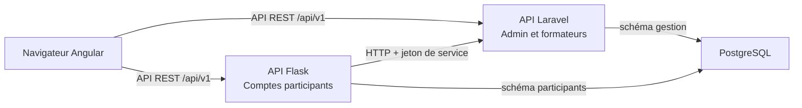

# SmartConseil — plateforme de gestion d’ateliers

Application web full stack réalisée pour l’exercice de développeur Full Stack
Angular / Laravel / Python. Elle permet de gérer des ateliers de formation et
les inscriptions de leurs participants.

## Fonctionnalités

| Profil | Fonctionnalités |
| --- | --- |
| Administrateur | Créer, modifier et supprimer des ateliers; gérer les formateurs; consulter les inscriptions et les participants. |
| Formateur | Consulter ses ateliers et les participants inscrits à ceux-ci. |
| Participant | Créer un compte, se connecter, consulter les ateliers disponibles, s’y inscrire et suivre ses inscriptions. |

Le [MCD](<./MCD_Plateforme_Ateliers.pdf>) présente les entités, leurs relations
et la séparation des données entre les deux API.

## Architecture



- **Angular** fournit l’interface et communique avec Laravel pour les écrans
  d’administration et de formateur, et avec Flask pour le parcours participant.
- **Laravel** est la source de vérité pour les ateliers, les formateurs et les
  inscriptions. Son API REST, protégée par Sanctum et des contrôles de rôles,
  gère ces ressources.
- **Flask** gère les comptes et l’authentification des participants. Il appelle
  Laravel par HTTP pour afficher le catalogue et créer une inscription. Le jeton
  Laravel utilisé par Flask reste côté serveur.
- **PostgreSQL** héberge les données dans des schémas distincts. Laravel possède
  le schéma `gestion`; Flask possède `participants`. Laravel conserve une
  référence minimale au participant pour afficher les listes d’inscrits. Les
  services échangent un UUID stable; ils ne lisent pas directement les tables
  appartenant à l’autre service.

## Choix techniques

| Technologie | Version retenue | Justification |
| --- | --- | --- |
| Angular, TypeScript, RxJS | Angular 16.2, TypeScript 5.1, RxJS 7.8 | Angular 16 est une version autorisée par le sujet et fournit le routage, les services HTTP, les formulaires réactifs et les composants modulaires requis. |
| Node.js | 18.20 | Environnement compatible avec la version Angular retenue. |
| Laravel, PHP, Sanctum | Laravel 13, PHP 8.3+, Sanctum 4 | Laravel gère l’API métier, les migrations, la validation, l’ORM Eloquent et l’authentification des équipes. |
| Flask, Python, SQLAlchemy | Flask 3.1, Python 3.12, SQLAlchemy 2 | Flask fournit une API légère pour les participants; SQLAlchemy persiste leurs comptes avec un ORM. Flask-Migrate/Alembic versionne le schéma Python. |
| Requests | 2.32 | Requests permet à Flask d’appeler l’API Laravel avec un délai d’attente et un jeton serveur. |
| PostgreSQL | 17 | Base relationnelle commune, avec des schémas et des migrations séparés selon le propriétaire des données. |
| API | REST, JSON, `/api/v1` | Format simple et versionné pour les échanges entre le navigateur et les deux API. |

Angular 16 et Node.js 18 sont retenus pour respecter le cadre de l’exercice; ce
sont des versions anciennes à prendre en compte pour un nouveau projet.

## Prérequis

- Windows PowerShell (les commandes ci-dessous sont prévues pour Windows).
- PHP 8.3 ou supérieur et Composer.
- Python 3.12.
- Node.js 18 et npm.
- PostgreSQL 17 en fonctionnement.

## Installation locale

Les services utilisent une même base PostgreSQL, mais chacun possède son propre
schéma. Les fichiers `.env` sont locaux et ne doivent pas être commités.

### 1. Créer la base PostgreSQL

Dans pgAdmin ou `psql`, créez un rôle et une base. Remplacez le mot de passe par
un secret local; exécutez les commandes séparément:

```sql
CREATE ROLE smartconseil_app WITH LOGIN PASSWORD 'choisir-un-mot-de-passe';
CREATE DATABASE smartconseil OWNER smartconseil_app;
```

### 2. Installer et configurer Laravel

Dans un nouveau terminal PowerShell, depuis la racine du dépôt:

```powershell
cd "Back-end Laravel"
composer install
if (-not (Test-Path .env)) { Copy-Item .env.example .env }
```

Dans `Back-end Laravel/.env`, renseignez `DB_CONNECTION=pgsql`,
`DB_HOST=127.0.0.1`, `DB_PORT=5432`, `DB_DATABASE=smartconseil`,
`DB_USERNAME=smartconseil_app` et le mot de passe créé précédemment. Puis:

```powershell
php artisan key:generate
php artisan config:clear
php artisan migrate
php artisan app:create-admin
php artisan serve --host 127.0.0.1 --port 8000
```

La commande `app:create-admin` demande le nom, l’adresse courriel et un mot de
passe administrateur. Les migrations Laravel créent les tables du schéma
`gestion`.

### 3. Créer un jeton de service Laravel

Après avoir démarré Laravel, ouvrez un autre terminal PowerShell et remplacez
les identifiants ci-dessous par ceux de l’administrateur créé à l’étape
précédente:

```powershell
$api = 'http://127.0.0.1:8000/api/v1'
$login = Invoke-RestMethod -Method Post -Uri "$api/auth/login" `
    -ContentType 'application/json' `
    -Body (@{
        email = 'admin@example.test'
        password = '<mot-de-passe-admin>'
    } | ConvertTo-Json)
$headers = @{
    Authorization = "Bearer $($login.access_token)"
    Accept = 'application/json'
}
$service = Invoke-RestMethod -Method Post -Uri "$api/auth/python-token" `
    -Headers $headers
$service.access_token
```

Copiez le jeton affiché uniquement dans le fichier `.env` local de Flask, sous
`LARAVEL_SERVICE_TOKEN`. Ne l’insérez jamais dans Angular ni dans le dépôt Git.
Si vous aviez déjà créé un jeton avant cette mise à jour, générez-en un nouveau
afin qu’il possède aussi le droit de lecture des inscriptions.

### 4. Installer et configurer Flask

Dans un troisième terminal PowerShell, depuis la racine du dépôt:

```powershell
cd "Back-end Python"
py -3.12 -m venv .venv
.\.venv\Scripts\python.exe -m pip install -r requirements.txt
if (-not (Test-Path .env)) { Copy-Item .env.example .env }
```

Dans `Back-end Python/.env`, configurez:

- `DATABASE_URL` vers la base `smartconseil`, avec le rôle PostgreSQL créé plus
  haut; encodez les caractères spéciaux du mot de passe dans l’URL.
- `JWT_SECRET_KEY` avec une clé privée d’au moins 32 caractères.
- `LARAVEL_API_URL=http://127.0.0.1:8000/api/v1`.
- `LARAVEL_SERVICE_TOKEN` avec le jeton obtenu à l’étape précédente.

Pour générer une clé JWT locale:

```powershell
.\.venv\Scripts\python.exe -c "import secrets; print(secrets.token_urlsafe(48))"
```

Pour une base neuve, appliquez les migrations Python:

```powershell
.\.venv\Scripts\flask.exe --app app db upgrade
```

Cela crée le schéma `participants` sans modifier le schéma Laravel `gestion`.
Si la base contient déjà une table participant créée par l’ancienne commande
`init-db`, sauvegardez-la, vérifiez sa structure et suivez la procédure
d’adoption décrite dans le [guide Python](<./Back-end Python/README.md>) avant
d’exécuter des migrations.

Lancez Flask et laissez ce terminal ouvert:

```powershell
.\.venv\Scripts\python.exe -m flask --app app run --host 127.0.0.1 --port 5000 --debug
```

### 5. Installer et démarrer Angular

Dans un autre terminal PowerShell, depuis la racine du dépôt:

```powershell
cd "Front-end Angular"
npm ci
npm start -- --host 127.0.0.1
```

L’application est disponible à `http://127.0.0.1:4200`. Les URL locales des API
sont définies dans la configuration Angular: Laravel sur le port `8000` et Flask
sur le port `5000`.

## Exemple d’échange Python ↔ Laravel

Le navigateur envoie à Flask l’identifiant de l’atelier; il ne choisit pas
l’identité du participant:

```http
POST http://127.0.0.1:5000/api/v1/inscriptions
Authorization: Bearer <jeton-du-participant>
Content-Type: application/json

{"workshop_id":"<uuid-atelier>"}
```

Après avoir authentifié le participant, Flask construit la requête Laravel à
partir de son propre compte. Exemple de l’appel serveur-à-serveur:

```python
import requests
from flask import current_app

response = requests.request(
    "POST",
    f"{current_app.config['LARAVEL_API_URL'].rstrip('/')}/integration/inscriptions",
    headers={
        "Accept": "application/json",
        "Authorization": (
            f"Bearer {current_app.config['LARAVEL_SERVICE_TOKEN']}"
        ),
    },
    json={
        "workshop_id": "<uuid-atelier>",
        "participant_id": "<uuid-du-participant-authentifie>",
        "nom_affiche": "Camille Martin",
        "email": "camille@example.test",
    },
    timeout=(3, 10),
)
body = response.json()
```

Laravel vérifie les places disponibles et les doublons dans une transaction,
puis répond par exemple:

```http
HTTP/1.1 201 Created
Content-Type: application/json
```

```json
{
  "data": {
    "id": "<uuid-inscription>",
    "workshop_id": "<uuid-atelier>",
    "participant_id": "<uuid-du-participant>",
    "status": "inscrit",
    "registered_at": "<date-heure-ISO-8601>"
  }
}
```

La réponse réelle contient également les objets `workshop` et `participant`.
Flask relaie le corps JSON et le code HTTP à Angular. Un atelier complet produit
un code `409 Conflict`; un jeton de service valide est requis côté Laravel.

## Tests et vérifications

Exécutez les commandes depuis le dossier correspondant:

```powershell
# Laravel — nécessite PostgreSQL configuré dans .env
cd "Back-end Laravel"
php artisan test

# Flask — tests unitaires avec une base SQLite temporaire
cd "..\Back-end Python"
.\.venv\Scripts\python.exe -m unittest discover -s tests -v

# Angular — tests unitaires
cd "..\Front-end Angular"
npm test -- --watch=false
npm run build
```

Si vous utilisez Brave au lieu de Chrome, définissez le chemin du navigateur
avant les tests Angular:

```powershell
$env:CHROME_BIN = 'C:\Program Files\BraveSoftware\Brave-Browser\Application\brave.exe'
npm test -- --watch=false
```

Le test Playwright participant vérifie la création de compte, la connexion,
l’inscription et sa visibilité dans la liste administrateur:

```powershell
npm run test:e2e
```

Ce test crée des enregistrements persistants. Exécutez-le uniquement lorsque
Laravel et Flask utilisent une base PostgreSQL **jetable** configurée comme
décrit dans le [guide Angular](<./Front-end Angular/README.md>).

## Guides détaillés

- [Guide Laravel](<./Back-end Laravel/README.md>)
- [Guide Python / Flask](<./Back-end Python/README.md>)
- [Guide Angular](<./Front-end Angular/README.md>)
